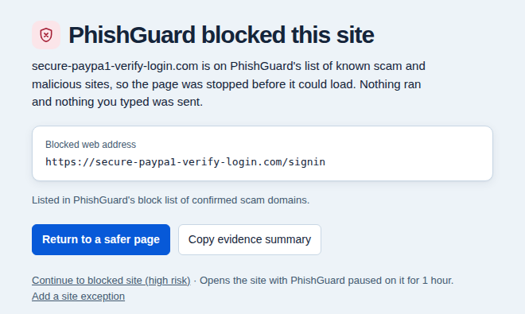
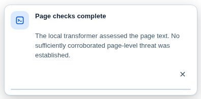

<div align="center">


# PhishGuard

### Understand the warning. Decide what to do next.

A browser extension that checks webpages for signs of phishing and scams, explains what it finds, and offers a way to leave a flagged page.

[Download PhishGuard and the complete source]([PASTE-RELEASE-URL-HERE]([url](https://github.com/pbaruah1/PhishGuard/releases/tag/v1.0.1)))

**On-device page analysis · Plain-language reasons · Browser-based controls**

[How it works](#how-it-works) · [Try it](#try-it) · [Privacy](#privacy) · [For developers](#for-developers)

</div>

---

## What PhishGuard does

A familiar logo or convincing message does not tell you where a link leads or where a form sends information. PhishGuard checks those details while you browse supported webpages.

| When you encounter… | PhishGuard checks… |
| :--- | :--- |
| A link that resembles a familiar website | The destination address, lookalike spelling, and known-threat rules. |
| A page asking for sensitive information | Form structure and destinations, alongside other page evidence. |
| A message that sounds like a scam | Its text using a packaged local model. A text score alone cannot establish that the page is malicious. |
| Suspicious instructions or actions | Signals associated with fake updates, tech-support scams, command-paste tricks, clipboard manipulation, and wallet-request abuse. |
| A QR code on a webpage | Supported QR-code destinations through the extension's inspection controls. |

These checks help identify warning signs. They cannot detect every scam or guarantee that a page is safe.

## What it looks like



*A project capture of the blocked-page interface using a demo address. The warning identifies the address and provides a return button.*

## How it works

1. **Check the address.** Packaged blocking rules can stop matching known-threat destinations.
2. **Inspect the page.** Local checks examine links, forms, page text, and selected behaviors within the browser's access and performance limits.
3. **Check the evidence.** Model output is evaluated alongside technical observations. Suspicious wording by itself is not enough for the local text fallback to declare a malicious page.
4. **Explain the result.** The interface displays a status and, when applicable, reasons and actions. Relevant page changes can trigger another assessment.



**“No corroborated threat” means the checks did not establish a threat. It does not mean the website has been certified safe.**

## Try it

**Current status: development candidate.** This README does not claim Chrome Web Store approval. The Chrome package requires desktop Chrome 138 or newer.

If the maintainer has attached a compiled `phishguard-chrome.zip` to a GitHub release:

1. Download that ZIP and extract it into a permanent folder.
2. Open `chrome://extensions` in Chrome.
3. Turn on **Developer mode**.
4. Click **Load unpacked** and select the extracted folder containing `manifest.json`.
5. Pin PhishGuard from Chrome's Extensions menu, then open a normal HTTPS webpage.

Use the toolbar popup to check the current status and site controls. Where offered, open the explanation, request another check, or report an incorrect warning. On a blocked page, use the return button to leave.

No Node.js, Python, terminal, or local server is needed to run the compiled extension. Developers need the tools listed below to build it from source.

## Privacy

Ordinary page analysis runs in your browser. The packaged text model includes its weights and runtime; text inference does not need a model-host request.

- Form inspection uses field types and destinations rather than collecting the values you type into those fields.
- Settings, history, and feedback can be kept in browser storage.
- Public threat-list downloads and site-icon requests can use the network and reveal ordinary request metadata to their hosts.
- Community reporting is off by default and needs a configured relay plus user opt-in.
- Optional remote URL inspection is unavailable unless the publisher configures a service. It is not configured in the supplied development build.
- Eligible Chrome devices may offer optional Gemini Nano activation; Chrome can download that model separately.

Read the repository's [data-handling policy](privacy.html) for details, coverage limits, and optional features.

## Current limits

The supplied release report records successful automated checks and packaged text-model inference. Full browser validation and representative accuracy evaluation remain incomplete. Performance varies by device and page.

The local text model is English-focused. Browser-internal pages, protected surfaces, inaccessible frames, closed shadow roots, and content outside collection limits cannot all be inspected. Chrome's ordinary desktop-extension installation does not work on Chrome for Android or iOS.

## Why I am building it

My grandmother lost her retirement savings to a scam. I began working on PhishGuard because I wanted to turn what I was learning about cybersecurity into something a person could use while deciding whether to trust a page. My work focuses on detection rules, testing, and explanations people can understand.

— Prajeet Baruah

<details>
<summary><strong>For developers</strong></summary>

### Build and test

Install Node.js 20 or newer with npm. From the project folder:

```powershell
npm ci
npm run test:unit
npm run build
npx playwright install chromium
npm run test:e2e
```

Stop and investigate failures before releasing. Browser tests are development tooling; users do not install Playwright.

Compiled packages are written to `dist/phishguard-chrome.zip` and `dist/phishguard-firefox.zip`. The Chrome staging directory is `dist/chrome`.

### Main components

| Component | Tools |
| :--- | :--- |
| Extension | JavaScript, Chrome Manifest V3, content scripts, background service worker |
| Interface | HTML and CSS |
| Local models | URL and page models; BERT-small via ONNX Runtime Web / WebAssembly |
| Build and verification | esbuild, Node test runner, Playwright browser tests |

See [PUBLISHING.md](PUBLISHING.md) for release preparation and publishing instructions.

</details>

## Feedback and license

Use this repository's Issues tab for bugs and suggestions. Include the browser version, what you expected, and what happened. Remove private page contents, account details, and tokens before posting. For sensitive security findings, follow [SECURITY.md](SECURITY.md).

Distributed under [GPL-3.0-or-later](LICENSE). Third-party notices and component licenses are retained in [NOTICE](NOTICE) and [LICENSES](LICENSES).
